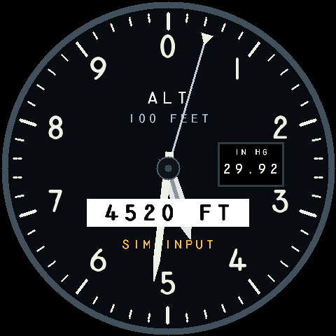

# Round Flight Instruments v0.1

A Rust instrument-display prototype for the **Waveshare ESP32-S3-Touch-LCD-2.8C
(SKU 29086, 480 x 480, 16 MiB flash)**. This release provides a simulated
three-pointer altimeter, touch barometer adjustment, a text CLI and a smooth
0–10,000 ft demonstration. The full six-pack is planned; only the altimeter
has a hardware renderer today.

**Bench/simulation use only. Not validated or certified for flight.** The onboard
IMU is available for diagnostics; it does not drive the gauge.



*Software-rendered preview. Instrument lettering: Leonardo Di Lena / MS33558C.*

## Get it running on your Waveshare

You need the exact board above, a data-capable USB cable, and a Windows PC with
Python 3.11. **The prebuilt firmware does not require Rust.**

1. Download and extract **[round-instruments-v0.1-waveshare-29086.zip](https://github.com/scottnortman/round-flight-instruments/releases/download/v0.1/round-instruments-v0.1-waveshare-29086.zip)** from the [v0.1 release](https://github.com/scottnortman/round-flight-instruments/releases/tag/v0.1).
2. Connect the board's **UART USB** port. Identify its CH343 COM port in Device
   Manager. The other USB connector does not provide this firmware's CLI.
3. Follow the **[board installation guide](docs/INSTALL-WAVESHARE.md)** (also
   included as `INSTALL.md` in the ZIP): install the Python tools, verify the
   download, back up your original firmware, and flash the supplied image.
   Replace the example `COM5` with your own port; close other serial terminals.
4. Open PuTTY or another serial terminal at **921600 baud, 8 data bits, no parity,
   1 stop bit, no flow control**. Disable terminal local echo: the board echoes
   characters. Initial boot logs use 115200 and may look garbled briefly.
5. Enter these commands, waiting for each `OK` response:

```text
sim preset level
instrument altimeter
baro 29.92
sim takeoff 60
```

The gauge holds zero for one second, climbs to 10,000 ft over 60 seconds, then
holds there. On a fresh boot, missing altitude and a red X are expected until
you supply simulated data. Settings and simulated values reset on reboot.

## Control the gauge

Hold the Kollsman pressure window for **0.25 seconds**; it turns blue while pressed.
Release, then use **−/+** for 0.01 inHg steps or **29.92** to reset the draft.
**Apply** changes the barometric offset; **Cancel** or 30 seconds of inactivity
leaves the active value unchanged. [Touch details](docs/TOUCH.md).

Popup buttons also turn blue while pressed. A short chirp acknowledges each new
screen press; use `touch sound off` to mute or `touch sound on` to re-enable it.

| CLI command | Result |
| --- | --- |
| `help` / `status` | Commands and current data/validity |
| `sim set pressure_altitude_ft 8500` | Hold a manual simulated altitude |
| `sim takeoff 60` / `sim takeoff stop` | Start/stop the climb demonstration |
| `baro 30.01` | Change the indicated-altitude offset |
| `touch status` / `touch hold 250` | Touch diagnostics / hold time in milliseconds |
| `touch sound on` / `touch sound off` / `touch sound status` | Screen-press chirp controls and diagnostics |
| `display stats` | Last rendering measurement; the climb records this automatically |
| `imu on`, `imu read`, `imu off` | Optional sensor diagnostics; gauge stays simulated |

The bundled Python client provides line editing: `python cli.py --port COM5`.
In a source checkout use `python scripts/cli.py --port COM5`. Type `exit` to
release the port. See the [complete CLI reference](docs/CLI.md).

## Run the PC simulations

Clone this repository and run these commands from its root:

```powershell
git clone https://github.com/scottnortman/round-flight-instruments.git
cd round-flight-instruments
git checkout v0.1
```

**Interactive browser gauges** (Node.js and Python):

```powershell
Push-Location apps/browser-sim
npm run check
npm run build
Pop-Location
python -m http.server 8000 --bind 127.0.0.1 --directory apps/browser-sim/dist
```

Open <http://127.0.0.1:8000>. This is a separate JavaScript visual reference with
multiple gauges and manual/demo controls; it does not connect to the board.

**Shared Rust simulation** (Rust/Cargo and Python):

```powershell
cargo build -p desktop-cli --locked
python scripts/cli.py
cargo run -p instrument-ui --example snapshots --locked
```

The desktop CLI uses the board's validation and command logic. It is text-only;
the snapshot example writes 30 still PPM images to `output/gauge/` using the
actual Rust renderer. [Detailed PC setup](docs/GETTING-STARTED.md).

## Development, verification and limits

Portable Rust crates separate instrument state, protocol, touch gestures,
rendering and sensor drivers from ESP-IDF board support. One state owner applies
validated commands; input freshness, display supervision and watchdogs remain
independent of rendering. See [architecture](docs/DISPLAY.md) and
[control contracts](docs/BASELINE.md).

- **72 Rust tests** and five browser regression suites pass. Normal hardware
  animation measured **32.33 FPS** with IMU polling; repeated popup/setting
  activity measured **29.22 FPS**. These are measured workloads, not minimum-rate
  guarantees. [Verification and reset investigations](verification/TOUCH.md).
- Other hardware gauges, touch instrument selection, an encoder, persistent
  settings and faster communications remain future work.
- The IMU has an unresolved stationary gyro offset; its readings and bench tilt
  are not calibrated attitude. [IMU limitations](docs/IMU.md).
- Building firmware uses a separate Cargo workspace and ESP-IDF 5.5.5. The
  development scripts contain workstation paths and guard the original board;
  new owners should use the prebuilt install route or follow
  [hardware development setup](docs/GETTING-STARTED.md#hardware-development).

```powershell
cargo test --workspace --locked
cargo clippy --workspace --all-targets --locked -- -D warnings
```

This README is the canonical release overview. Detailed setup, contracts and
dated evidence live in `docs/` and `verification/`. Older handoff notes are
historical. [Release notes](docs/releases/v0.1.md).

## License and AI assistance

Original code and documentation: **[Apache-2.0](LICENSE)**. Third-party assets
retain their own terms, including the instrument font; see [NOTICE](NOTICE) and
[third-party notices](THIRD-PARTY-NOTICES.md).

Developed with **OpenAI ChatGPT and Codex**, under Scott Nortman's direction,
with automated checks and physical bench testing. AI assistance is not a
correctness or flight-safety guarantee.
