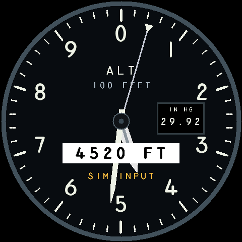

# Round Flight Instruments

**v0.2.0** packages the accepted eight-screen firmware and Windows app. The user
confirmed both work as expected on November 18, 2026. The Windows app retains
its tested **0.2.0-test.13** build identifier; binaries are promoted without
recompilation. See [release notes and installation](docs/releases/v0.2.0.md)
and [release verification](verification/RELEASE-v0.2.0.md).

Use manual **live aircraft-profile delivery**: save a profile, click
**Use on connected board**, then check tray Status for board confirmation.
The Combined VSI now matches the standalone left-zero orientation and scale.
See [installation and tests](docs/MSFS-TEST-13.md) and
[verification](verification/PROFILE-LIVE.md).

The menu includes **CALIBRATE**: guided upright LEVEL and FULL
24-pose IMU calibration, explicit review/save, persistent coefficients, and
calibrated six-axis Madgwick fusion. Hold center for one second, release, then
tap CALIBRATE. Read the [calibration and validation instructions](docs/IMU-CALIBRATION.md)
before collecting a level reference. Independent physical/dynamic IMU accuracy
remains unqualified.

The firmware includes a seventh **COMBINED** flight-panel screen and a
tap-to-hide numeric altitude window with a permanent white outline. See
[controls and layout](docs/CONSOLIDATED.md) and
[verification](verification/CONSOLIDATED.md).

Every screen also has a **DEMO** menu button: automatic motion with IMU tilt
where useful. Tap it again to return to normal data. See [demo controls](docs/DEMO.md).

The native Windows editor saves aircraft
profiles and previews all eight faces. Test.13 delivers the manually selected
profile to the connected board. See [profile editor usage](docs/PROFILE-EDITOR.md).

The board remembers its selected gauge
and stores a persistent UUID. Hold center, release, then tap **INFO** for the
firmware revision and UUID. See [device settings, CLI and aircraft-profile
design](docs/DEVICE-SETTINGS.md).

The **three-miss display hold** retains the accepted interruption policy:
brief late frames retain the last reading; the fourth consecutive miss blanks.
See [policy and CLI](docs/DISPLAY-HOLD.md) and [verification](verification/DISPLAY-HOLD.md).

The **v0.2.0-rc.8** six-pack foundation implements all six faces: Airspeed,
Attitude, Altimeter, Magnetic Heading, Turn Coordinator and Vertical Speed.
The user reported all tests working on November 4, 2026. See the
[six-pack guide](docs/SIX-PACK.md), [verification](verification/SIX-PACK.md)
and [flash/RAM budget](docs/MEMORY-BUDGET.md).

Latest downloadable release: **[v0.2.0](https://github.com/scottnortman/round-flight-instruments/releases/tag/v0.2.0)**,
with six standard faces, Combined and DEBUG, the test.13 Windows installer and
the accepted November 9 firmware. Earlier prereleases remain available.
The rc.8 rapid local CLI-switching deadline limit is recorded in the
[baseline verification](verification/SIX-PACK.md#open-inherited-limit-aggressive-local-cli-switching);
rc.9 includes the bounded-hold fix above.

The native Windows tray connector starts at sign-in, reconnects automatically,
and transports all-six instrument data. Background gauges are read-only; only
explicit active-gauge actions can write aircraft controls. See
[host installation](docs/WINDOWS-DRIVER-SETUP.md) and
[architecture/status](docs/WINDOWS-DRIVER.md).

MSFS 2020 works in the user-tested configuration; MSFS 2024 and other aircraft
remain unqualified. The installer is unsigned and includes the
unmodified Microsoft SimConnect runtime with its separate license and notices.

A Rust instrument-display prototype for the **Waveshare ESP32-S3-Touch-LCD-2.8C
(SKU 29086, 480 x 480, 16 MiB flash)**. The release provides a simulated
three-pointer altimeter, touch barometer adjustment, a text CLI and a smooth
0-to-10,000 ft demonstration, a standalone attitude renderer and touch gauge selection.
All six standard faces, Combined and DEBUG are included. MSFS 2020 input and optional two-way barometer
control are bench-tested on the Just Flight Piper Warrior. See the
[MSFS setup guide](docs/MSFS-TWO-WAY-TEST.md).

**Bench/simulation use only. Not validated or certified for flight.** The onboard
IMU supports diagnostics, uncalibrated accelerometer tilt and calibrated six-axis
attitude bench testing. It is not an aircraft attitude reference.



*Software-rendered preview. Instrument lettering: Leonardo Di Lena / MS33558C.*

## Get it running on your Waveshare

Download the firmware ZIP, Windows installer and checksums from the
**[v0.2.0 release](https://github.com/scottnortman/round-flight-instruments/releases/tag/v0.2.0)**,
then follow the **[release installation guide](docs/releases/v0.2.0.md#installation)**.

Use the board's **UART USB** connector. Python is needed only for backup/flashing;
prebuilt firmware and the native tray app require no Rust toolchain. The Windows
installer goes on the PC running MSFS 2020. It upgrades in place; no uninstall is
needed. If you already use the tested test.13 app and November 9 firmware pair,
no reinstall or reflash is needed; those exact binaries are preserved.

For standalone use, open the CLI at **921600 / 8N1 / no flow control**, local echo
off, and enter `sim preset level`, then `sim takeoff 60`. Hold the center for
1 second, release, then select a face, or run `sim attitude 60` / `sim turn 60`. Hold the
pressure window for 0.25 seconds to edit it. Boot output uses 115200; an initial
red X means no data has been supplied yet. Close the terminal before using MSFS.

## Gauge selection and attitude demonstration

Hold the dial center for **1 second**, release,
then tap a gauge to select it. All eight screens are enabled
with local simulation or the tray app's T2 stream. Source-incompatible
choices remain disabled. Active
buttons turn blue and chirp. Set the volatile hold with `touch menu hold 1000`.
See [touch gauge menu and current MSFS limits](docs/GAUGE-MENU.md).

The standalone attitude face follows the phone prototype. For a local motion
exercise after building/flashing the current source:

```text
source sim
sim preset level
instrument attitude
display on
sim attitude 60
```

Use `sim set pitch_deg 10` or `sim set roll_deg 30` for manual poses and
`instrument altimeter` to return. See the [attitude guide](docs/ATTITUDE.md)
and [verification record](verification/ATTITUDE.md). For handheld debugging,
`source imu` selects onboard attitude with an **IMU BENCH** label; hold the
screen upright facing you. Accepted calibration enables guarded six-axis Madgwick
fusion; otherwise the 15-sample accelerometer tilt fallback is used. See
[calibration and limits](docs/IMU-CALIBRATION.md) and
[IMU bench controls](docs/IMU-ATTITUDE.md).
The 15-sample IMU motion and adjusted 30/60 bank labels were visually accepted.
See the [IMU checkpoint and verification](verification/IMU-ATTITUDE.md).
The legacy T1 profile transports Altimeter only. The installed tray app uses
T2 for all six faces and permits live gauge selection without restarting.

## Control the gauge

Hold the Kollsman pressure window for **0.25 seconds**; it turns blue while pressed.
Release, then use **-/+** for 0.01 inHg steps or **29.92** to reset the draft.
**Apply** changes the barometric offset; **Cancel** or 30 seconds of inactivity
leaves the active value unchanged. On Combined, tap/release its outlined QNH
button for the same editor. Read-only, DEMO and calibration block aircraft edits.
[Touch details](docs/TOUCH.md).

Popup buttons also turn blue while pressed. A short chirp acknowledges each new
active-control press; use `touch sound off` to mute or `touch sound on` to re-enable it.

| CLI command | Result |
| --- | --- |
| `help` / `status` | Commands and current data/validity |
| `sim set pressure_altitude_ft 8500` | Hold a manual simulated altitude |
| `sim takeoff 60` / `sim takeoff stop` | Start/stop the climb demonstration |
| `sim airspeed 60` / `sim heading 60` / `sim vsi 60` | Demonstrate the scalar gauges |
| `baro 30.01` | Change the indicated-altitude offset |
| `touch status` / `touch hold 250` | Touch diagnostics / hold time in milliseconds |
| `touch sound on` / `touch sound off` / `touch sound status` | Active-control chirp controls and diagnostics |
| `display stats` | Last rendering measurement; the climb records this automatically |
| `imu on`, `imu read`, `imu off` | Sensor acquisition/diagnostics; does not change the selected source |
| `source imu` / `source sim` | Select upright IMU attitude bench mode / return to simulation |

The source checkout's Python client provides line editing:
`python scripts/cli.py --port COM5`. Type `exit` to
release the port. See the [complete CLI reference](docs/CLI.md).

## Run the PC simulations

Clone this repository and run these commands from its root:

```powershell
git clone https://github.com/scottnortman/round-flight-instruments.git
cd round-flight-instruments
git checkout v0.2.0
```

**Interactive browser gauges** (Node.js and Python):

```powershell
Push-Location apps/browser-sim
npm run check
npm run build
Pop-Location
python -m http.server 8000 --bind 127.0.0.1 --directory apps/browser-sim/dist
```

Open <http://127.0.0.1:8000>. This is a separate JavaScript visual reference with
multiple gauges and manual/demo controls; it does not connect to the board.

**Shared Rust simulation** (Rust/Cargo and Python):

```powershell
cargo build -p desktop-cli --locked
python scripts/cli.py
cargo run -p instrument-ui --example snapshots --locked
```

The desktop CLI uses the board's validation and command logic. It is text-only;
the snapshot example writes 30 still PPM images to `output/gauge/` using the
actual Rust renderer. [Detailed PC setup](docs/GETTING-STARTED.md).

## Development, verification and limits

**MSFS integration:** the installed native Rust tray connector transports all
six instruments, enrolls the board by USB identity and recovers automatically
from simulator, aircraft and USB changes. Its isolated SimConnect worker can be
replaced without restarting the app. Simulator readings remain authoritative;
only explicit Apply actions on Altimeter or Combined can write the barometer.
Background gauges stay read-only. The user has tested MSFS 2020; other simulator
versions and aircraft require qualification. DCS is planned.

Use the [Windows host setup guide](docs/WINDOWS-DRIVER-SETUP.md) and
[six-pack test checklist](docs/SIX-PACK.md). The older Python bridge and its
manual restart instructions are historical; a terminal or Python script is not
needed for ordinary installed use. Keep optional diagnostic queries off during
normal operation to avoid their timing impact.

Portable Rust crates separate instrument state, protocol, touch gestures,
rendering and sensor drivers from ESP-IDF board support. One state owner applies
validated commands; input freshness, display supervision and watchdogs remain
independent of rendering. See [architecture](docs/DISPLAY.md) and
[control contracts](docs/BASELINE.md).

- **297 Rust workspace/all-target tests** with the MSFS feature, strict Clippy,
  and **20 Python integration tests** pass for this release. All-six local
  motion runs measure 32.33-32.41 completed FPS; continuous text telemetry
  measures 30.80-32.33 FPS. The native MSFS-path timing/load tests also pass;
  [results and open limits](verification/SIX-PACK.md) distinguish the workloads.
- Profiles support manual live selection; automatic aircraft matching,
  multi-device host management, an encoder, faster
  communications and DCS support remain future work.
- The high stationary gyro offset remains a hardware warning. Saved calibration
  corrects measured bias for bench fusion; independent FULL-24/dynamic accuracy,
  absolute yaw and gyro scale remain unqualified. [IMU limits](docs/IMU-CALIBRATION.md).
- Building firmware uses a separate Cargo workspace and ESP-IDF 5.5.5. The
  development scripts contain workstation paths and guard the original board;
  new owners should use the prebuilt install route or follow
  [hardware development setup](docs/GETTING-STARTED.md#hardware-development).

```powershell
cargo test --workspace --all-targets --features instrument-connector/msfs --locked
cargo clippy --workspace --all-targets --features instrument-connector/msfs --locked -- -D warnings
```

This README is the canonical release overview. Detailed setup, contracts and
dated evidence live in `docs/` and `verification/`. Older handoff notes are
historical. [Checkpoint notes](docs/releases/v0.2.0-rc.1.md) and
[standalone release notes](docs/releases/v0.1.1.md).

## License and AI assistance

Original code and documentation: **[Apache-2.0](LICENSE)**. Third-party assets
retain their own terms, including the instrument font; see [NOTICE](NOTICE) and
[third-party notices](THIRD-PARTY-NOTICES.md).

Developed with **OpenAI ChatGPT and Codex**, under Scott Nortman's direction,
with automated checks and physical bench testing. AI assistance is not a
correctness or flight-safety guarantee.

The release includes an eighth [DEBUG telemetry screen](docs/DEBUG.md),
ASCII-only Windows profile editor titles, and a verified 1,000 ms menu hold.
See [MSFS test instructions](docs/MSFS-TEST-13.md). The ten existing T2 quantities
are unchanged; DEBUG displays the received values, age and validity.
