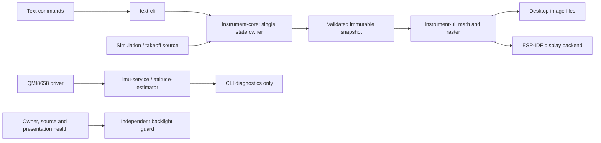

# Round Flight Instruments

Portable round flight instruments, developed from a browser visual prototype
into Rust firmware for one selectable display. Safety, correctness, explicit data
validity, and separation of instrument logic from hardware are the design priorities.

**Status: November 1, 2026.** The Waveshare ESP32-S3-Touch-LCD-2.8C (SKU 29086)
now runs a simulated altimeter with UART control, a smooth altitude sweep,
supervised display output, and optional onboard IMU diagnostics. The full
six-pack is the destination; only the altimeter has a Rust gauge renderer today.

**This README is the canonical project overview and current-status reference.**
Use the [getting-started guide](docs/GETTING-STARTED.md) for step-by-step setup.
Detailed contracts live in `docs/`; dated observations live in `verification/`.
Earlier handoff and architecture notes are historical and do not override the
current implementation or this status.

This is a bench prototype. It is not certified or validated for aircraft use.
The browser models, IMU diagnostics and simulated inputs must not be treated as
operational air data, attitude or navigation information.


*Software-rendered preview from the shared Rust snapshot example; not a photograph
of the LCD. Font attribution: Leonardo Di Lena / MS33558C, see the asset notice.*

The `graphics-cleanup` branch adjusts the Rust altimeter's numeral spacing and
raises the Kollsman window; the preview above reflects that layout. Physical
spacing was accepted on the board, and a 20-second steady check measured
15.49 FPS without unexpected blanking. See the
[graphics cleanup verification](verification/GRAPHICS-CLEANUP.md).

## Contents

- [Three ways to run the project](#three-ways-to-run-the-project)
- [Quick start](#quick-start)
- [Implemented features and remaining work](#implemented-features-and-remaining-work)
- [Using the board and CLI](#using-the-board-and-cli)
- [Architecture](#architecture)
- [Safety and correctness](#safety-and-correctness)
- [Rendering performance and known issues](#rendering-performance-and-known-issues)
- [Development and verification](#development-and-verification)
- [Repository map](#repository-map)
- [Documentation and evidence](#documentation-and-evidence)
- [Git, publishing and licensing](#git-publishing-and-licensing)

## Three ways to run the project

| Mode | What runs | What it demonstrates |
| --- | --- | --- |
| Browser gauge simulator | JavaScript/SVG in `apps/browser-sim` | Interactive visual gauges, demo sequences, manual sliders, data-loss demonstrations and optional local phone motion |
| Rust desktop simulation | `apps/desktop-cli` and shared Rust crates | The same validation, state ownership, timestamps, simulated inputs and text protocol used by the board; separate raster snapshots exercise the actual Rust gauge renderer |
| Board firmware | `firmware/console` on Waveshare SKU 29086 | Physical 480 x 480 RGB display, UART CLI, watchdog/backlight supervision, and QMI8658 diagnostics |

These are distinct programs. The browser is the visual/model reference; it does
not connect to the board or share a live process with the Rust CLI. The Rust CLI
is text-based, with no live desktop gauge window yet. Its snapshot example
writes still images using the same renderer as the board. Do not infer firmware
feature support from the richer browser prototype.

## Quick start

Commands below run from the repository root in Windows PowerShell. See the
[full guide](docs/GETTING-STARTED.md) for prerequisites, expected results,
troubleshooting, firmware setup and a new-board checklist.

### Interactive PC gauge simulations

With Node.js and Python installed:

```powershell
Push-Location apps/browser-sim
npm run check
npm run build
Pop-Location
python -m http.server 8000 --bind 127.0.0.1 --directory apps/browser-sim/dist
```

Open <http://127.0.0.1:8000>. No npm package installation is needed. Select a
gauge, run its demo, or adjust its sliders/presets. Use the data selector to
explore failures. Stop the server with Ctrl+C.

Available views are **Heading, Airspeed, Turn coordinator, Attitude, Altimeter,
and Attitude + altitude**. Heading is the opening view; there is no browser VSI
renderer yet. These are illustrative bench models, not a flight simulator.
Airspeed markings use an explicit C172S example profile, not universal aircraft
limits. Phone input is disabled on desktop. A supported phone can open its own
HTTPS-hosted copy and use its local sensors; relative heading is not magnetic or
true north, and airspeed/altitude remain simulated. See the
[browser guide](apps/browser-sim/README.md) and
[model reference](apps/browser-sim/REFERENCE.md).

### Shared Rust desktop CLI

With desktop Rust and its Windows C++ build prerequisites installed:

```powershell
cargo build -p desktop-cli --locked
python scripts/cli.py
```

The Python client starts a fresh desktop simulation and provides a prompt/local
line editing. Desktop mode uses Python's standard library. Type one command at
a time and wait for the reply:

```text
help
sim preset level
instrument altimeter
status
sim takeoff 10
sim takeoff status
sim takeoff stop
sim set pressure_altitude_ft 8500
baro 29.92
status
```

Type `exit` in the Python client to close it. For the raw protocol without the
client, run `cargo run -p desktop-cli --locked`. Desktop `display`/physical `imu`
operations report unsupported; they do not simulate successful hardware calls.

### Rust gauge snapshots on the PC

```powershell
cargo run -p instrument-ui --example snapshots --locked
```

This generates 24 PPM images under `output/gauge/`: valid, manual 8500 ft, zero,
negative altitude, changed barometer, missing, stale and failed states at
240, 480 and 720 pixels. The getting-started guide includes PNG conversion.
These are software renders, not LCD photographs.

## Implemented features and remaining work

| Capability | Browser | Rust desktop / board |
| --- | --- | --- |
| Altimeter | Interactive three-pointer gauge | Shared math/raster renderer; physical board output verified |
| Attitude | Interactive pitch/bank and combined view | Inputs and estimator boundary exist; gauge renderer pending |
| Airspeed | Simulated KIAS, explicit aircraft profile | Input/selection present; renderer pending |
| Heading | Simulated or phone-relative heading | Input/selection present; renderer pending |
| Turn coordinator / ball | Simulated or local phone motion | Input/selection present; renderer pending |
| VSI | Pending | Input/selection present; renderer pending |
| Command protocol | Browser controls only | Shared text CLI; desktop stdin/stdout and board UART |
| Takeoff test | Browser has its own demo sequences | `sim takeoff [SECONDS]` animates 0 to 10000 ft |
| Fault handling | Per-module visual failures | Per-quantity validity/freshness, fault injection, presentation supervision |
| IMU | Optional phone APIs | QMI8658 driver, self-test/audit, raw values and bench tilt; not a gauge source |
| Touch / encoder | Browser mouse/touch UI | Board touch selection pending; encoder interface later |
| Settings persistence / faster transport | Not shared with firmware | Pending; board settings are volatile |

Selecting an unimplemented Rust gauge shows a clear placeholder, rather than
leaving the old altimeter visible. The planned hardware arrangement is one
board with one screen that switches instruments. Rust and hardware portability
remain requirements. Next milestones are attitude rendering, touch selection,
calibrated and validated sensor fusion, then the remaining six-pack renderers.
A faster communications protocol needs explicit integrity/session semantics.

## Using the board and CLI

The tested board is **Waveshare ESP32-S3-Touch-LCD-2.8C, SKU 29086**; PCB revision
is unknown. Use the **UART USB port** through the CH343 adapter for the current
development, flashing and application console workflow. The other connector is
the ESP32-S3 native USB interface; the current application does not expose its
CLI there.

| Connection | Settings |
| --- | --- |
| Application console | **921600 baud, 8N1**, no hardware/software flow control |
| ROM / boot / early initialization | 115200 baud |
| Flash tool | 460800 baud, independent of the application console speed |
| This workstation's verified UART | COM5; re-identify after reconnects. COM4 is unrelated on this workstation |

Use a data-capable USB cable and allow only one program to hold the UART port.
With PySerial installed, connect from the repository root:

```powershell
python scripts/cli.py --port COM5
```

The client does not request a reset. Its `exit` command releases the port while
the board keeps running. Direct serial terminals should disable local echo:
firmware character echo starts on. `echo on`, `echo off`, and `echo status`
control it. The Python client temporarily disables firmware echo and restores
it on normal close. Firmware does not implement backspace editing; use the
Python client when local editing is wanted. Wait for a readable `READY` line
after flashing/reset; boot output can be garbled at the application baud rate.

### Altimeter and animated test

```text
sim preset level
instrument altimeter
display gauge
display on
sim set pressure_altitude_ft 8500
baro 29.92
sim takeoff
```

`sim takeoff` selects the altimeter, sets 29.92 inHg, resumes sampling, holds
zero for one second, climbs linearly to 10000 ft over 60 seconds, then holds
10000 ft. `sim takeoff 30` uses a 30-second climb; accepted whole seconds are
5 through 600. This is an accelerated altitude-only animation, not aircraft
performance simulation.

```text
sim takeoff status
sim takeoff stop
display stats
display stats reset
display stats stop
```

Statistics reset when a sweep starts and freeze at completion/stop. `display
stats` measures completed presentations per second, maximum draw time and
transfer time, rather than LCD refresh rate or uncapped rendering capacity.
Only queried responses are printed; completion does not emit unsolicited text.
A source ramp can finish before its endpoint frame is physically presented.

### Manual controls and failure demonstrations

| Command | Meaning |
| --- | --- |
| `instrument list` | List six instrument identifiers |
| `status` | Read selected view, source, timing, values, quality and ages |
| `sim set FIELD VALUE` | Stage a finite, in-range input for the next running sample |
| `sim clear pressure_altitude_ft` | Remove altitude; healthy renderer shows missing-data indication |
| `sim pause` / `sim resume` | Stop/restart sample publication; paused data ages to stale |
| `fault pressure_altitude_ft on` / `off` | Inject/remove altitude failure; recovery needs a new sample |
| `display status` | Inspect software presentation and guard status |
| `display off` / `on` | Request backlight disable/enable subject to supervision |
| `imu on`, `imu status`, `imu read`, `imu estimator`, `imu off` | Inspect physical sensor diagnostics separately from simulated gauges |

Manual altitude changes, preset or pause cancel a takeoff sweep. Resume does
not restart a cancelled sweep. Active altitude/timing faults prevent starting;
no test command silently clears them. Reboot starts with missing data and
volatile defaults. At 29.92 inHg, simulated pressure altitude and indicated
altitude agree; changing barometer applies the retained browser simulation
formula once. No real pressure sensor or calibrated air-data model exists yet.

Read [docs/CLI.md](docs/CLI.md) for every field, range, freshness threshold,
framing rule and error. The protocol is case-sensitive ASCII with a 128-byte
line limit and one request/reply at a time. There are no sequence numbers,
checksums, authentication or retransmission. Queued text status is not live
flight telemetry.

## Architecture

The domain core is synchronous and has one state owner. Hardware I/O, rendering
and transport execute outside that owner. The current board uses Rust `std`
with ESP-IDF/FreeRTOS tasks; **Embassy is not the selected executor**. Async or
Embassy can be evaluated later without moving instrument logic into drivers.



| Component | Responsibility |
| --- | --- |
| `instrument-core` | Dependency-free `no_std` state, units, validation, quality, monotonic timing and takeoff source |
| `text-cli` | Bounded `no_std` framing, parser and replies |
| `console-runtime` | State-owner loop, separate blocking RX/TX workers, bounded queues and snapshots |
| `instrument-ui` | `no_std` instrument math, geometry, RGB565 raster, optional caller-owned backdrop cache; forbids unsafe code |
| `qmi8658` | Portable bounded register driver, read locking, identity/readback checks, self-test and audit |
| `attitude-estimator` | Pure filter contract, timestamp/quality checks, resets and optional covariance/bias hooks for future Kalman work |
| `imu-service` | Sensor worker and diagnostic snapshots, replaceable estimator; currently bench tilt only |
| `firmware/console` | SKU-specific pins, UART, I2C, panel initialization, DMA ownership, RTOS priorities, watchdog and backlight guard |

A new display/MCU should supply a backend and board adapter while retaining the
core, protocol, instrument math and render contracts. Portability is a design
boundary, not a claim that a second hardware target has been validated.

## Safety and correctness

- Missing, zero, stale, failed and timing-fault values are distinct. Invalid
  readings carry no usable numeric value and cannot retain plausible pointers.
- Each quantity retains its acquisition timestamp. Queries/rendering do not
  refresh samples; snapshot transit and render time count toward expiry.
- Nonfinite/out-of-range commands are rejected without partially changing state.
  Bounded framing discards malformed/overlong lines through their terminator.
- The owner targets a 20 ms period; a gap over 100 ms or clock regression latches
  a timing fault. `sim resume` cannot clear that fault.
- Blocking input/output and drawing run separately from the owner. The owner
  and independent display guard are subscribed to a one-second task watchdog.
- The backlight guard checks owner progress, source lifetime, completed
  presentation and scanout activity. A stalled renderer is blanked; a healthy
  renderer can draw an explicit stale/missing/failure face.
- Two scanout buffers and bounded completion waits protect DMA ownership. The
  static backdrop is CPU-only and never submitted to scanout.

These are implemented safeguards with bench evidence, not proof against every
failure. Tasks share CPU, RTOS and power; there is no established independent
hardware fail-dark guarantee. Healthy frame counters cannot prove optical
correctness. See [display contracts and limits](docs/DISPLAY.md).

## Rendering performance and known issues

The verified 60-second sweep completed **944 presentations in 61019 ms
(15.47 FPS)**, versus 6.13 FPS before static-face caching and pacing changes.
Maximum draw time was 35 ms, transfer 47 ms and owner gap 30 ms. The user
confirmed smoother motion with clean edges and no blanking/shift. This is an
observed run, below the earlier 30 FPS target, not a worst-case guarantee.
[Measurement and evidence](verification/TAKEOFF.md).

A duplicated bottom arc/damaged left edge was eliminated by disabling forced
restart on every VSYNC at the normal 18 MHz pixel clock. Lowering the clock to
12 MHz did not resolve it. The build script checks the generated configuration
to prevent re-enabling that setting; conditional SDK recovery remains enabled.
[Investigation](verification/DISPLAY-SCANOUT.md).

The optional IMU responds, but stationary Y gyro readings near +30 degrees/s
remain unresolved. Diagnostic tilt is not calibrated attitude and is not routed
to gauges. Kalman extension hooks exist; no validated fusion solution is claimed.
The current application consumes 898224 of a 1048576-byte application partition
(85.66%), despite 16 MiB physical flash. Budget partition capacity before adding
substantial features. Board touch, persistence and binary transport remain open.

## Development and verification

```powershell
cargo test --workspace --locked
cargo clippy --workspace --all-targets --locked -- -D warnings
cargo fmt --all -- --check
cargo build -p desktop-cli --locked
python scripts/cli.py --test --slow --report output/desktop-acceptance.json
python scripts/check-takeoff.py --seconds 5 --report output/desktop-takeoff.json
```

Create `output/` first if needed (`New-Item -ItemType Directory -Force output`).
Desktop checks were rerun for the initial Git baseline: 49 Rust tests and five
browser suites pass. Hardware acceptance is recorded separately and is not
implied by host tests. Hardware test scripts change board state; some inject
faults and blank the display. The watchdog script flashes a deliberately
stalling build and is not part of basic onboarding.

Firmware uses its own workspace/lockfile, toolchain `esp`, and ESP-IDF 5.5.5:

```powershell
.\scripts\Build-Console.ps1
```

This compiles without flashing. It verifies the generated SDK settings and
records matching build artifacts. The current scripts require workstation
configuration; follow the [hardware guide](docs/GETTING-STARTED.md#hardware-development)
before running them on another PC. Use `Flash-Console.ps1` only after matching
the correct board and verifying its recovery backup. Never use `--release` as
an untested substitute for the validated firmware profile.

## Repository map

```text
apps/browser-sim/       JavaScript/SVG visual reference and tests
apps/desktop-cli/       Rust stdin/stdout simulation runner
crates/                Portable core, protocol, UI, IMU and estimator modules
firmware/console/      ESP32-S3/ESP-IDF hardware adapter and separate lockfile
scripts/               Windows builds, guarded flashing, CLI and bench checks
docs/                  Getting started and subsystem contracts
verification/          Dated reports and retained machine-readable evidence
tools/toolchain-check/ Compile-only ESP toolchain probe
```

Generated `output/`, browser `dist/`, Rust build trees, downloaded vendor trees,
local checkpoints, firmware archives and factory flash backups are ignored.
They are not recovered by cloning this repository. Lockfiles and required font/
raster assets are tracked. Factory backups can contain device-specific state;
keep verified recovery copies separately.

## Documentation and evidence

| Read | Purpose |
| --- | --- |
| [Getting started](docs/GETTING-STARTED.md) | PC browser/CLI/raster walkthrough, serial control, toolchain setup and troubleshooting |
| [CLI protocol](docs/CLI.md) | Commands, fields, units, ranges, framing and errors |
| [Display architecture](docs/DISPLAY.md) | Current renderer, buffers, guard, expiry and diagnostic behavior |
| [IMU](docs/IMU.md) | Driver diagnostics, capture workflow and unresolved bias |
| [Estimator contract](docs/ATTITUDE-ESTIMATOR.md) | Filter interfaces and future Kalman boundary |
| [Control baseline](docs/BASELINE.md) | State-owner and transport design; dated console-only descriptions are historical |
| [Verification index](verification/README.md) | Links to staged hardware evidence and limitations |
| [Initial Git baseline](verification/GIT-BASELINE.md) | Host checks, clean source export, public-file review and documentation verification |
| [Takeoff/performance](verification/TAKEOFF.md) | Current sweep behavior and measured rendering improvements |
| [Toolchain record](tools/README.md) | Installed versions and historical provisioning/backup details |
| [Browser reference](apps/browser-sim/REFERENCE.md) | Original visual models, phone axes and browser tests |
| [Third-party notices](THIRD-PARTY-NOTICES.md) | Font provenance and upstream references |

Update this README whenever supported gauges, setup commands, safety behavior,
hardware configuration or the next milestone changes. Preserve dated test
reports as evidence; do not silently rewrite old observations as current results.

## Git, publishing and licensing

The project now uses a local Git repository on `main`. The initial commit captures
the browser source, Rust source, scripts, documentation and verification evidence.
No remote is required for local development. After creating an empty repository
in your own public account, use the actual URL in place of `YOUR-ACCOUNT`:

```powershell
git status --short
git remote add origin https://github.com/YOUR-ACCOUNT/round-flight-instruments.git
git push -u origin main
```

Create the remote without an extra README/license/initial commit to avoid an
unrelated history. If a remote named `origin` already exists, inspect it with
`git remote -v` instead of adding it again. Publishing is performed by the owner.

Original project code and documentation are licensed under the
[Apache License 2.0](LICENSE). See [NOTICE](NOTICE) for attribution. Third-party
assets retain their own terms, especially the embedded MS33558C font; see
[THIRD-PARTY-NOTICES.md](THIRD-PARTY-NOTICES.md). The font is not relicensed under
Apache-2.0. The upstream toolchain-check scaffold retains its MIT notice.
Packages that bundle the font declare `Apache-2.0 AND CC-BY-ND-4.0` to identify
both sets of terms; original program code remains Apache-2.0.

### Developed with AI assistance

This project was developed with **OpenAI ChatGPT and OpenAI Codex** under the
project owner's direction. ChatGPT assisted with the browser prototype and
handoff; Codex assisted with Rust implementation, hardware integration, tests,
debugging and documentation. Hardware behavior was checked through automated
bench tests and the owner's physical observations. AI assistance is not a
correctness guarantee or flight-safety certification; remaining limitations and
the evidence supporting each milestone are documented explicitly.
