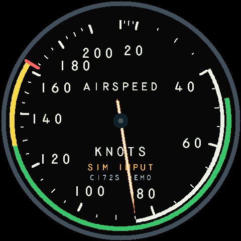

# Airspeed gauge

Accepted source checkpoint: **v0.2.0-rc.8**, merged from
`feature/complete-six-pack`, based on `v0.2.0-rc.7`, carrying
the original `feature/airspeed-gauge` work forward with Heading and VSI.
The portable Rust renderer follows the phone-tested Airspeed face in
`apps/browser-sim/src/airspeed.js` and `instrument-fragment.html`.



The face shows **indicated airspeed in knots (KIAS)** on the reference's
nonlinear 0–200 scale. Zero is valid data. Missing, failed or stale IAS removes
the needle and shows the corresponding warning. A valid external reading above
200 shows **OVER RANGE** and the actual IAS, without a wrapped or pegged pointer.
TAS and groundspeed are never substitutes for missing IAS. The white needle has
a thin bright-orange outline; inset numerals leave space from the tick marks.

## Controls and CLI

Select **Airspeed** from the three-second center-hold menu. The existing blue
pressed feedback and active-control chirps apply. Airspeed is available in
local simulation and the T2 external profile; T1 and IMU do not supply IAS.

At 921600 / 8N1 / no flow control, with the tray app disconnected:

```text
source sim
sim preset level
instrument airspeed
display on
sim airspeed 60
```

The bounded 5–600-second exercise moves smoothly from zero through 200 KIAS
and returns to 85. `sim airspeed stop` holds the current value;
`sim airspeed status` reports progress. Starting another demo, changing source,
pausing, resetting the preset, editing/clearing IAS or faulting IAS stops it.
It cannot run over an external or IMU source.

For manual checks, use `sim set ias_kt 0`, `85`, `120`, `163` or `200`;
`sim clear ias_kt`; and `fault ias_kt on` / `off`. Local manual inputs retain
their existing 0–200 range. The wider external measurement range remains
independent of dial geometry. `display sample` includes `shown_ias_kt` and
`ias_over_range`; `display status` identifies `renderer=airspeed`.

## Aircraft limits and future configuration

The user approved example arcs **only in local simulation**: white 40–85,
green 48–129, yellow 129–163 and a red mark at 163 KIAS. The face labels them
**C172S DEMO**, matching the phone prototype's example. These values are not
generic limits for other aircraft. All external sources omit the arcs and show
**LIMITS NOT SET** until aircraft-specific configuration is implemented.

`airspeed::Profile` validates an independent monotonic scale and optional
`Limits`; model tests exercise a different 0–400 profile. This preserves the
configuration boundary without inventing a host protocol yet. Host-PC profile
selection, persistence and transport are TBD. Future configuration must bind
limits to the correct aircraft/session and invalidate that binding on aircraft
changes before any limits are displayed.

The current MSFS connector already carries IAS and its serviceability flag,
so no host protocol or installer update is required for data. Its older Status
text may still list Airspeed as unavailable; the updated device menu is
authoritative. Development host source replaces that hardcoded availability text.
Changing gauges still sends no aircraft control; only the Altimeter's explicit
barometer Apply action can request writeback.

## Rendering and verification

One additional retained backdrop uses 460,800 bytes of PSRAM. Existing DMA
buffers, shared navigation cache and internal Attitude foreground storage are
reused. The background/damage keys include the limits mode, so local arcs cannot
remain after switching to external data. No per-frame allocation is added.

Freshness stays at the existing **1,000 ms locally / 500 ms externally**. True
source ages are retained. Airspeed does not inherit Attitude/Turn's extended
presentation grace. Independent owner, rendering and scanout guards remain
active. Deliberate data-expiry checks can engage the deadline guard while the
invalid view replaces the old numeric frame; healthy-stream tests separately
require no added expiry or blanking.

Host Rust tests cover profile validation, exact reference scale positions,
monotonic movement, zero versus missing data, over-range handling, exact expiry,
demo isolation, and full-reference comparisons through motion, faults, menu and
source transitions on rotating buffers at 240 and 480 pixels.

Run `scripts/check-airspeed.py` for real-UART semantics and performance, then
`scripts/check-memory.py` for all four faces. MSFS-path timing tests are available
as `normal-airspeed` and `loaded-airspeed` in `scripts/check-msfs-host.py`.
See [the hardware verification record](../verification/AIRSPEED.md).

References: [FAA Pilot's Handbook, flight instruments](https://www.faa.gov/sites/faa.gov/files/regulations_policies/handbooks_manuals/aviation/phak/10_phak_ch8.pdf),
[MSFS SimConnect shim and IAS definition](../crates/simconnect-native/native/shim.cpp).
