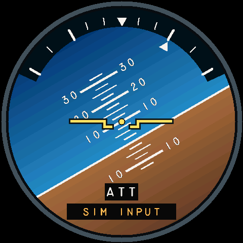

# Standalone attitude gauge

Development branch: `feature/attitude-gauge`. The board passes the normal
60-second motion test at **32.33 completed FPS**, with no observed numeric
deadline misses or unexpected blanking. Missing/stale/fault and independent
blanking tests also pass. On November 2, 2026, the user visually accepted the
repeated motion exercise: smooth motion, no tearing and no artifacts.
See [the verification record](../verification/ATTITUDE.md). This branch is not
a released firmware package.



## Visual reference

The source is the phone-tested standalone `AttitudeModule(..., false)` in
[the browser prototype](../apps/browser-sim/src/instrument-fragment.html).
The separate combined attitude/altitude layout is not implemented here.

The Rust face preserves the 480-unit viewport, 224-unit horizon disk, original
MS33558C lettering, yellow fixed aircraft symbol, pitch marks at 2.5/5/10 degrees,
4.5 units per degree, and bank marks at 10/20/30/45/60 degrees. Positive pitch
moves the horizon down. Positive right bank rotates the horizon counterclockwise;
the pointer moves clockwise toward the bank on the fixed scale.

RGB565 rendering uses the original sky/earth gradient endpoints in discrete
bands. The dark bank-scale backing and the ATT/source captions are opaque for
readability. These are raster adaptations of the SVG reference, not pixel-identical
browser rendering. Full-resolution fonts and geometry remain 480 x 480 on the board.

## Input and CLI

Both desktop and board use the existing validated `pitch_deg` and `roll_deg`
fields. Pitch is nose-up positive, -90 through +90 degrees; roll is right-bank
positive, -180 through +180. Selection changes the view without resetting inputs.

```text
source sim
sim preset level
instrument attitude
display on
sim set pitch_deg 10
sim set roll_deg 30
```

`display on` applies to the board. Desktop CLI reports state without a display.
To return to the altimeter, use `instrument altimeter`.

```text
sim attitude 60
sim attitude status
sim attitude stop
```

The synthetic exercise selects attitude, smoothly transitions through level,
pitch up, right bank, left bank, pitch down, and level, then holds level. Default
duration is 60 seconds; allowed duration is 5–600 seconds. It runs in the state
owner at a 100 Hz bench-source sampling cadence, with no serial command stream needed.
Stop holds the current pose. Manual pitch/roll edits, clearing either axis, pause,
source changes and faults stop the exercise; invalid commands cannot change it.
It is a bench animation, not a flight-dynamics model.

The onboard QMI8658 remains a diagnostic source. This gauge does not implicitly
enable it or use uncalibrated sensor axes. Existing estimator/Kalman interfaces
remain separate. The current external T1/MSFS profile carries altitude/barometer
only: selecting attitude with that source shows missing attitude, never fallback
simulated or fabricated level data. Attitude telemetry integration is later work.

## Correctness and rendering

`instrument-ui::attitude` is portable `no_std` Rust with no unsafe code. It
consumes immutable validated readings; acquisition and filtering remain outside
the renderer. Both axes must be valid, finite, in range and younger than 100 ms.
Missing, stale, failed and timing-fault states clear the horizon, ladder and
aircraft symbol and display a red X plus the reason.

Snapshot transport and render delay add to the older axis's age. Submission and
the independent display supervisor use the original deadline. No frame-rate
optimization may reset timestamps, extend freshness or disable watchdogs.

The three-buffer pipeline remains unchanged. Each buffer owns its previous
attitude and damage tiles. Moving markings are erased using the new horizon;
unchanged color bands outside those tiles may be retained. Fixed foreground is
cached as opaque runs; the board keeps a compact 96 KiB cache in internal RAM
for fixed pixels and expanded original ladder glyphs. It copies opaque runs after
motion. The board uses 512 run descriptors; no per-frame glyph allocations occur. Smaller or absent cache storage falls back
to the full backdrop. Source-label changes rebuild the cache. Full redraw remains the pixel-equivalence reference.
The board captures snapshots closer to the next transfer slot and polls
completion counters between bounded drawing stages. A single-producer/single-consumer
atomic fence publishes the original numeric deadline in the second completion ISR,
before releasing the completion counter. Delayed drawing cannot delay this health
update. Buffer retirement also waits for that fence, including late-arm races. A progress callback cannot
access or mutate frame pixels, and never changes the original source deadline.
RGB interrupts are allocated on core 0; the sole raster worker is pinned to core 1.
The RTOS tick is 1 ms. The owner wait adapter rounds its remaining 10 ms sample
period up to scheduler ticks and always blocks for at least one tick. The raster
worker also guarantees idle time with a bounded one-tick fallback; both idle
watchdogs remain enabled. Simulation publication preserves its sampling
phase across jitter, skips missed slots and stamps only actual acquisition time.
External measurements keep their source ages.
There is no per-frame heap allocation or reduction in display resolution.

`display status` identifies the presented renderer. `display sample` includes
`shown_pitch_deg`, `shown_roll_deg`, quality and acquisition age. Attitude does
not report an altitude value as though it were visible.

## Reproduce and verify

```powershell
cargo test -p instrument-ui -p instrument-core -p text-cli --locked
cargo run -p instrument-ui --example attitude --release --locked
```

The example writes 36 PPM previews at 240/480/720 pixels to `output/attitude/`
and reports desktop CPU timing; that timing is not Waveshare FPS.

The board acceptance script exercises missing/failed/stale states, render and
transfer stalls, view switching, and a timed animation with IMU diagnostics on:

```powershell
python scripts/check-attitude.py --port COM5 --seconds 60 --report output/attitude-board.json
```

It requires at least **30 completed presentations/second**, no unexpected
blanking during animation and no owner timing fault. Physical smoothness,
orientation, flicker and artifacts also require visual acceptance. Performance
of cold initialization, abrupt extreme changes and fault transitions is recorded
separately from the normal-animation target.
