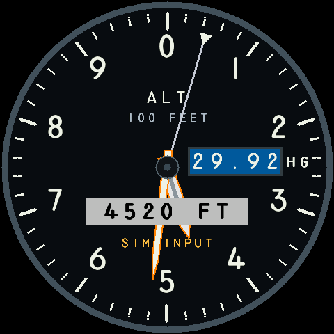
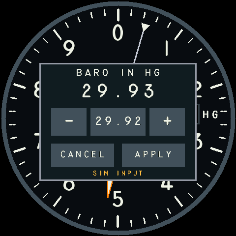

# Touch barometer editor

On the altimeter, hold one finger steadily inside the Kollsman window for
**0.25 seconds**, then lift. The window turns deep blue (`#005A9C`, RGB565 on
hardware) as soon as a valid opening press is recognized, keeping the regular
white digits. Releasing early or cancelling the gesture restores black; a
completed hold opens the adjustment overlay and ends the highlight. The color
is press feedback, not a change to the barometer setting.
Tap **−** or **+** to adjust the draft by **0.01 inHg**, within 28.10–31.00.
Tap **29.92** to reset the draft to standard pressure. Tap **Apply** to commit,
or **Cancel** to discard it. Buttons act on release;
holding a button does not auto-repeat. At startup, contact is unknown until a
controller report arrives. A real release must be observed before arming a hold;
if an initial hold is ignored, lift and retry. The editor cancels after 30 seconds
without a new button interaction. Settings and hold duration reset on reboot.

All five popup buttons turn the same blue while a valid press is held. Sliding
off clears the highlight and cancels that tap; sliding back does not re-arm it.
White text is composited against the button's current background.

Accepted presses on the active Kollsman window or a visible popup button produce
one short chirp, enabled by default. Blank areas, hidden controls, popup labels,
and disabled/invalid gauge states stay silent. A chirp acknowledges the press,
not a successful setting change. Holding or dragging does not repeat; presses less than 150 ms apart may
be silent. `touch sound off` mutes it; `touch sound on` enables it again. This
preference is volatile. An observed release is required before the next chirp.





The main gauge continues to use the committed setting while editing. Apply
passes through the same `App::apply(Command::Baro(...))` validation as `baro`
over UART. It changes simulated indicated altitude and pointer positions via
the existing barometric correction. It does **not** change pressure-altitude
samples, source timestamps or validity. Touch edits are quantized to hundredths.
The simulation correction is not a calibrated operational air-data model.

## Controls and diagnostics

| Command | Behaviour |
| --- | --- |
| `touch status` | Controller identity readiness, hold duration, overlay/draft, last contact and age, polling/report/error counters |
| `touch hold 250` | Set hold threshold in whole milliseconds, 250–5000; cancels any edit |
| `touch cancel` | Discard the draft; the committed setting is unchanged |
| `touch sound on\|off\|status` | Enable/mute control feedback or inspect readiness, activity, beep/error counts |

These commands are parsed by the shared CLI and use the board display service;
desktop returns `ERR display_unsupported_target`. The pure interaction state
machine and renderer are tested on desktop. No command fabricates physical
touches. `ready=true` confirms initialization, not current sample freshness;
check age and error fields. A successful idle poll can refresh a known released
contact, but never refreshes an old held contact. `capture-touch.py` records raw
diagnostics and corresponding application/display state without changing settings:

```powershell
python scripts/capture-touch.py --port COM5 --seconds 30 --report output/touch.json
```

## Safety and ownership

The active buzzer uses TCA9554 output bit 7 (vendor EXIO8), active high, as shown
in the [Waveshare schematic](https://files.waveshare.com/wiki/ESP32-S3-Touch-LCD-2.8C/ESP32-S3-Touch-LCD-2.8C_schematic_diagram.pdf)
and vendor demo. Read/modify/write and readback preserve the other expander pins.
Only the shared I²C worker drives it. The UI owner emits an event only when its
interaction controller accepts a new press, using the same validation and hit
testing as blue feedback. A single atomic slot coalesces requests; events expire
after 120 ms and are consumed once. Mute and long-operation quiescing discard
pending requests. The worker no longer interprets raw touch contacts. A nominal
40 ms deadline turns it off on a subsequent worker poll, without sleeping for
the pulse. Long IMU commands and automatic cleanup first quiesce sound; failure
to confirm shutoff rejects a queued IMU command. Ordinary drawing adds no sound
I/O. This is feedback, not an alarm system.

Any buzzer I/O fault disables further chirps until reboot and retries shutoff
every 100 ms. `active_or_unknown=true` includes uncertain hardware state.
The 40 ms duration is not a hard guarantee: a persistently broken I²C bus can
prevent shutoff, including after mute. Diagnostics report that uncertainty.

- GT911 driver is `no_std`, allocation-free and independent of ESP-IDF. It verifies
  product ID and configured 480×480 bounds, reads 16-bit register addresses, and
  acknowledges each new report before publishing it. No-data is distinct from
  finger-up; malformed, out-of-range or failed transactions never become presses.
- SKU 29086 uses address 0x5D on SDA 15/SCL 7, touch reset EXIO2 (mask 0x02) and GPIO 16
  for address selection. Reset preserves other expander outputs. No configuration
  table or coordinate calibration is written. Native x/y matches the upright LCD;
  confirmed by the user's Kollsman and button interactions.
- Console and IMU command/response mailboxes use single-attempt `try_lock`
  operations on the owner path. Contention defers work instead of spinning on
  a preempted producer; only I/O workers use sleeping retry loops. See the
  [watchdog reset investigation](../verification/TOUCH-QUEUE-RESET.md).
- The existing sensor worker exclusively owns the one I²C driver. A bounded
  auxiliary poll runs between complete QMI8658 operations, including with IMU off.
  Touch/IMU transactions each retain 10 ms timeouts. The display/state owner only
  reads snapshots with `try_lock`; it never performs I²C or waits for that worker.
- Touch samples and owner scheduling gaps expire at 120 ms. Bus errors, stale data,
  multiple contacts, changed contact ID during a gesture or leaving the hold region
  prevent unintended actions. A hold permits at most 16 logical units of motion.
  New gestures require a release; the opening hold cannot activate a button.
- Press color is derived from the same validated hold state, so stale input,
  movement outside the hold area, multiple contacts or unavailable editing clear
  it. The renderer additionally suppresses it for invalid altitude or an open
  editor. It uses tracked dynamic drawing beneath the hands; the backdrop cache
  key is unchanged and no allocation, timer or extra bus read is added. Text
  antialiasing blends against blue rather than black.
- Actions wait until the display reports an editor frame presented, followed by
  finger release. This does not itself prove optical correctness; physical checks
  are still required. The UI uses the same independently supervised presentation
  path and automatic damage tracking as the gauge.
- Editor access requires valid altitude, selected altimeter, healthy visible
  display and normal gauge mode. Fault/stale data, display off/pattern/stall,
  instrument change or a changed committed barometer value cancels the draft.
  The editor never replaces an invalid-data warning. CLI `baro` wins conflicts.
- IMU startup/self-test may occupy the shared worker long enough to cancel a
  touch edit. The source and display still run independently. No stale touch is
  replayed after a long diagnostic operation.

## Reference and boundaries

The board controller, reset sequence, registers and native coordinate orientation
were checked against the [Waveshare SKU29086 documentation and demo](https://www.waveshare.com/wiki/ESP32-S3-Touch-LCD-2.8C),
particularly `main/Touch_Driver/GT911.c` and `GT911.h`. This implementation is
original Rust code; no LVGL dependency or vendor configuration blob was added.

Touch currently edits only the Kollsman setting. Instrument selection, encoder
input, persistence, acceleration/auto-repeat and other touch controls remain future
work. The UI controller and rectangular hit regions live in `instrument-ui`, while
reset/transport and polling publication stay at the board boundary.
