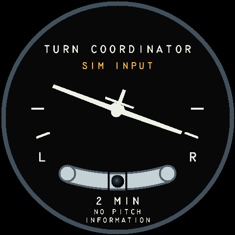

# Turn Coordinator

Source checkpoint: **v0.2.0-rc.5**, developed on `feature/turn-coordinator`
with the installed Windows connector/T2 foundation. Live MSFS acceptance is still
pending; this source checkpoint has no new binary release.

The face follows the phone-tested Turn Coordinator in
`apps/browser-sim/src/instrument-fragment.html`: miniature airplane, level and
standard-rate marks, curved ball tube, L/R and 2 MIN. The title sits above the
airplane motion area; NO PITCH / INFORMATION is centered on two footer lines. Rendering
uses the same portable Rust model and pixel sink on desktop and hardware.



## Use on the board

Hold the center for three seconds, release, and select **Turn**. The menu retains
blue pressed feedback and active-button chirps. Altimeter and Attitude remain
available; Airspeed, Heading and VSI remain disabled. Turn is available for local
simulation and the external T2 profile. T1 and IMU do not supply this face's data.

Open the UART CLI at 921600/8N1/no flow control, then enter:

```text
source sim
sim preset level
instrument turn
display on
sim turn 60
```

The bounded demo moves through right/left standard-rate turns, independently
displaces the ball left/right, then returns to centered zero rate. Duration is
5–600 seconds; default 60. `sim turn status` reports progress; `sim turn stop`
holds the current simulated values. Source changes, pause, relevant faults and
manual edits to either Turn field stop the exercise. Unrelated pitch edits do not.

Manual checks:

```text
sim set turn_dps 3
sim set ball 0
sim set ball -0.75
sim set ball 0.75
sim set turn_dps -3
fault turn_dps on
fault turn_dps off
sim set turn_dps 0
fault ball on
fault ball off
sim set ball 0
```

A faulted field requires a new valid sample after clearing the fault. The turn
indication and ball fail independently; missing data is never rendered as a
centered zero. `display status`, `display sample`, `status` and
`display stats reset` / `display stats stop` provide diagnostics.

## Meaning and correctness

`turn_dps` is the **instrument's effective turn-rate indication**, in degrees
per second; positive is right turn. It is not bank angle. The standard-rate marks
correspond to ±3°/s (a two-minute full turn), using the phone prototype's ±20°
airplane deflection. The visual indication saturates at ±45°, without changing
the source value. It carries no pitch information.

`ball` is normalized displacement, −1 left, 0 centered, +1 right. The phone's
17° curved tube geometry is retained. No bank-derived or fabricated ball is used.

The MSFS adapter already reads `TURN INDICATOR RATE` and `TURN COORDINATOR BALL`
with the turn-coordinator failure flag. Its instrument-rate reading goes straight
to the face; the phone raw-gyro roll/yaw projection must not be applied again.
MSFS cockpit agreement, rate/ball signs and aircraft-specific support still need
live validation on the simulator PC. The face sends no aircraft controls.

Local simulation retains a 100 ms freshness limit. The user approved 150 ms for
external turn and ball data, including acquisition, transport and presentation.
Each field keeps its actual age and expires independently. There is no automatic
IMU hold or synthetic fallback for external loss. Owner/scanout/render watchdogs
and DMA ownership are unchanged.

The board retains a separate CPU-only PSRAM backdrop so switching does not rebuild
other faces. All three scanout buffers keep their own damage history. Short-lived
gauges also use a CPU-only menu bitmap, prepared incrementally before the hold
can finish; menu lettering is not redrawn in full every frame. Short-lived
gauges capture closer to their next transfer slot; a gauge change bypasses that
wait. This improves sample age while retaining the same deadline.

## Verification and references

See [Turn Coordinator verification](../verification/TURN-COORDINATOR.md).
Generate 240/480/720-pixel Rust previews with:

```powershell
cargo run -p instrument-ui --example turn --release --locked
```

The portable model and renderer cover signs, standard-rate deflection, saturation,
independent missing/failed/stale fields, exact age limits and pixel equivalence
across three rotating buffers, motion, faults and touch overlays.

References: [FAA PHAK Chapter 8](https://www.faa.gov/sites/faa.gov/files/regulations_policies/handbooks_manuals/aviation/phak/10_phak_ch8.pdf)
and [MSFS instrument template](https://docs.flightsimulator.com/html/Content_Configuration/Models/ModelBehaviors/TemplateExplorer/Asobo/Common/Subtemplates/Instrument_Subtemplates.html).
